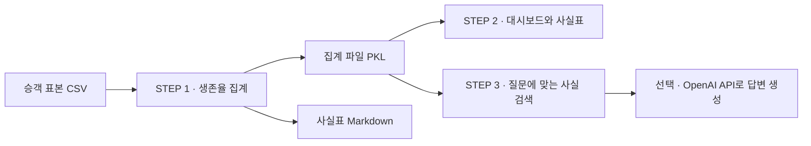

# 🚢 타이타닉 생존율 분석 실습

Seaborn 타이타닉 승객 표본 **891명**으로 성별·객실 등급별 생존율을 비교합니다. **CSV 집계 → Streamlit 대시보드 → 사실표를 근거로 질문하기**까지 순서대로 실습할 수 있습니다.

> OpenAI API 키 없이도 대시보드, 사실표, 질문에 맞는 근거 검색을 써 볼 수 있습니다.

## 🗺️ 전체 흐름 한눈에 보기



| 단계 | 하는 일 | 결과물 |
|---|---|---|
| **STEP 1. 데이터 집계** | 전체·성별·객실 등급별 승객 수와 생존율 계산 | `titanic_summary.pkl`, `titanic_facts.md` |
| **STEP 2. 결과 확인** | 막대그래프와 표에서 생존율을 비교하고 사실 ID 확인 | Streamlit 대시보드·사실표 |
| **STEP 3. 질문하기** | 질문의 키워드로 사실표를 검색하고, API 키가 있으면 답변 생성 | 검색 후보와 근거 ID가 붙은 답변 |

## 📁 파일 구성

| 파일 | 역할 |
|---|---|
| [`titanic.csv`](titanic.csv) | Seaborn 타이타닉 승객 표본 |
| [`analyze.py`](analyze.py) | CSV에서 생존율을 집계하고 결과 파일 2개 생성 |
| [`app.py`](app.py) | 대시보드·사실표·질문하기 탭을 표시 |
| [`rag.py`](rag.py) | 사실 검색과 OpenAI API 답변 생성 |
| [`requirements.txt`](requirements.txt) | Streamlit, pandas, OpenAI Python SDK 설치 목록 |
| [`titanic_facts.md`](titanic_facts.md) | 브라우저나 편집기에서 읽을 수 있는 사실표 |
| `titanic_summary.pkl` | 앱이 읽는 집계 및 사실표 데이터. `analyze.py` 실행 시 생성 |

## 📊 데이터에서 확인할 수 있는 것

| 비교 기준 | 표본에서의 생존율 |
|---|---|
| 전체 | **38.38%** (342명 / 891명) |
| 성별 | 여성 74.20% · 남성 18.89% |
| 객실 등급 | 1등급 62.96% · 2등급 47.28% · 3등급 24.24% |

각 그룹의 생존율은 **그룹 내 생존자 수 ÷ 그룹 내 탑승자 수 × 100**으로 계산합니다. 나이가 기록되지 않은 177명도 생존율 집계에 포함합니다. 그룹별 인원과 승선 도시는 [사실표](titanic_facts.md)에서 확인할 수 있습니다.

## 🖥️ 내 컴퓨터에서 실행하기

PowerShell에서 아래 명령을 순서대로 실행합니다.

```powershell
git clone https://github.com/sinyoungk0711-droid/titanic_streamlit.git
cd titanic_streamlit
python -m pip install -r requirements.txt
python analyze.py
python -m streamlit run app.py
```

브라우저에서 `http://localhost:8501`을 열고 탭을 선택합니다.

| 탭 | 할 수 있는 것 |
|---|---|
| **대시보드** | 전체 탑승자 수·생존자 수·생존율을 보고 성별과 객실 등급별 결과를 비교합니다. |
| **사실표** | 전체 생존 현황, 성별, 객실 등급, 나이 결측치, 승선 도시를 사실 ID와 함께 봅니다. |
| **질문하기** | 질문을 입력하고 **검색 후보 확인**을 펼쳐 어떤 사실이 검색됐는지 살펴봅니다. |

## 🤖 사실표에 질문하기

이 실습의 RAG는 **질문에 들어 있는 키워드로 사실표의 행을 찾고, 찾은 행을 모델에 전달해 답변을 만드는 방식**입니다.

| 예시 질문 | 확인할 근거 |
|---|---|
| 객실 등급별 생존율은 어떻게 달라? | `F-3` 객실 등급별 생존 현황 |
| 나이가 기록되지 않은 승객은 몇 명이야? | `F-4` 나이 결측치 |
| 승선 도시는 어디야? | `F-5` 승선 도시 |

키워드가 여러 주제에 걸치면 검색 후보가 여러 개 나올 수 있습니다. 일치하는 사실이 없으면 **확인 불가**가 표시됩니다.

### 선택 사항 · AI 답변 생성 켜기

같은 PowerShell 창에서 앱을 실행하기 전에 아래와 같이 API 키를 설정합니다. 앱이 이미 실행 중이면 `Ctrl+C`로 종료한 뒤 실행합니다.

```powershell
$env:OPENAI_API_KEY = Read-Host "OpenAI API 키" -MaskInput
python -m streamlit run app.py
```

기본 모델은 `gpt-5-mini`입니다. 다른 모델을 사용하려면 앱 실행 전에 `OPENAI_MODEL` 환경변수에 모델 이름을 지정합니다. 앱은 검색된 사실 ID를 인용한 답변을 표시합니다.

## 📌 데이터 출처

분석 수치는 저장소에 포함된 Seaborn 승객 표본을 기준으로 합니다. [Seaborn 원본 타이타닉 CSV](https://github.com/mwaskom/seaborn-data/blob/master/titanic.csv)
